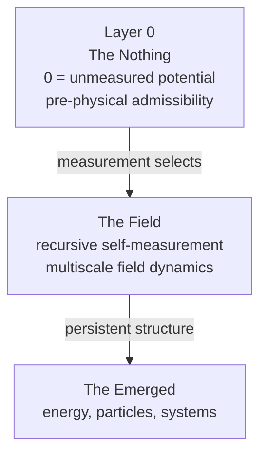

## Multiscale Field Dynamics Ontology

The key structure behind my work is best expressed as a resolution hierarchy, not a timeline:



This project does not derive the three bodies from first principles. It maps them onto a decomposition that can be computed against. The idea is that the field does not "evolve in time" in the usual sense; the scale index `n` is the fundamental parameter, and physical time is emergent.

### 1) Layer 0 — The Nothing / unmeasured potential

The uninstantiated space of possibilities before any distinction is actualized. In the source ontology this is **Layer 0 — ontological potential**: "not ordinary physical vacuum … pre-physical admissibility; timeless, pre-metric or proto-metric, unconstrained by realized law, not yet partitioned into observer and observed."

- Rigorous content: a configuration/possibility space with no realized dynamics — the set of admissible field states before a measurement interaction selects one.
- What it is not: a claim that "nothing" is a substance or a region. It is a boundary condition on description, not an object.

This is the crucial idea behind the notation:

> 0 = unmeasured potential

It is not empty absence. It is the unactualized space of what could be, before a field configuration becomes measurable.

### 2) The Field — recursive self-measurement / multiscale field dynamics

Where the primitives (distinction, relation, measurement, closure, stability, scale) become active. The rigorous object is a damped, geometry-constrained operator equation:

```text
∂²u + 2γ ∂u + L·u + N(u) = f
```

with:
- `u` = state
- `L` = geometry-dependent linear operator
- `N(u)` = nonlinear coupling
- `f` = forcing
- `γ` = damping

In practical terms, this is the layer of:
- spectral structure
- operator dynamics
- mode families
- couplings and damping
- circulation, winding, and basin structure
- recursive self-measurement across scale

### 3) The Emerged — energy, particles, systems

What survives recursive updating becomes structure, not new substance. The minimal law from the source corpus is:

> "whatever persists must be recursively distinguishable from its alternatives across repeated self-updating."

This layer includes:
- **Closure** as the geometric signature of persistence
- **Energy / particles** as stabilized, localized, persistent modes of the field
- **Systems** as hierarchies of closure: persistent modes binding into further persistent modes

### The three layers of reality (clear formulation)

1. **Layer A — Measurement / Phenomenal Layer**
   - What we directly observe: signals, time series, images, density matrices, and recorded outcomes.
   - Role: empirical traces of interaction between system and probe.

2. **Layer B — Field Computation Layer**
   - What the field computes: operators, eigenmodes, couplings, damping, and self-measurement dynamics.
   - Role: explains how patterns are generated and stabilized.

3. **Layer C — Generative / Meta-geometry Layer**
   - The deeper rules of admissibility, topology, resonance, and stable information packing.
   - Role: constrains what field computations are possible and preferred.

How they relate:
- **Layer C** sets the prior and admissible space of operators and configurations.
- **Layer B** implements the dynamics and produces measurable outputs.
- **Layer A** records the outcomes; inference moves from A → B and then toward constraints on C.

This is the meta-structure behind my work: the universe is not only the measured surface, but the nested relation between possibility, computation, and persistence.

---